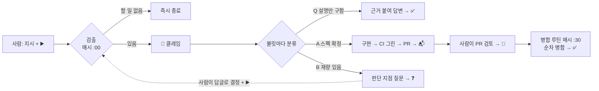
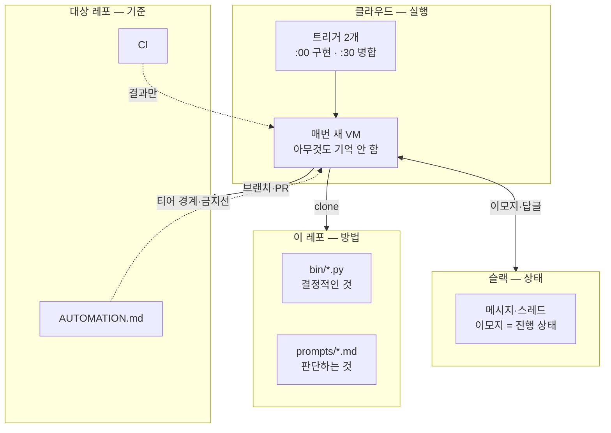
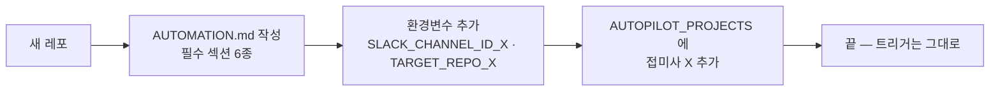
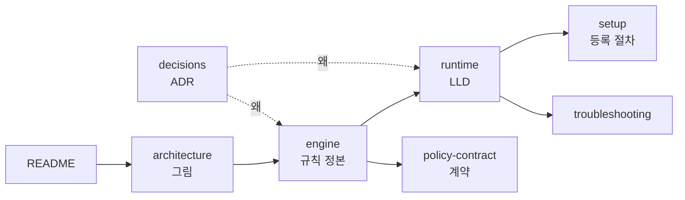

# slack-autopilot

슬랙 채널에 적은 개발 지시를 클라우드 루틴이 매시간 주워서 **답하거나, 구현해 PR 로 만들거나,
사람에게 되묻는** 범용 엔진. 사람이 하는 일은 셋뿐이다.

| | 사람이 하는 일 | 그러면 |
|---|---|---|
| ✍️ | 채널에 지시를 불릿으로 쓴다 | 아직 아무 일도 없다 |
| ▶️ | 그 메시지(또는 스레드 답글)에 ▶️ 를 단다 | 다음 정각에 봇이 집는다 |
| 🚀 | 봇이 올린 PR 을 읽고 PR 링크 답글에 🚀 를 단다 | 다음 :30 에 봇이 병합한다 |

▶️·🚀 는 **사람만** 달 수 있다 — 봇이 달려고 하면 코드가 예외로 막는다(D-002). 그래서 봇이
자기 일을 스스로 다시 시작하는 루프가 구조적으로 생기지 않는다. 허용 목록 밖의 사람이 단
▶️·🚀 도 없는 것으로 본다(D-010).

## 한눈에

**❓ 는 막다른 길이 아니라 대기열이다.** 사람이 결정 한 줄을 답글로 적고 ▶️ 를 달면, 그 답글이
새 지시가 되어 처음으로 돌아간다. 재량(B)이 스펙(A)으로 바뀌는 이 길이 시스템의 처리량을 정한다.

## 무엇이 어디에

| | 어디 | 무엇 |
|---|---|---|
| **엔진**(범용) | 이 레포 | 상태 기계·검출·락·자기 수정·병합 절차 |
| **정책**(프로젝트별) | 각 대상 레포의 `AUTOMATION.md` | 티어 경계·검증·병합 금지선·결정 기록 규칙 |
| **검증** | 대상 레포의 CI | 테스트·e2e. 엔진은 결과만 읽는다 |
| **실행** | 클라우드 루틴(cron) | 매시 폴링. 유휴면 즉시 종료 |

## 설계의 축

- **상태는 슬랙에 있다.** 루틴은 매 실행이 새 세션이고 아무것도 기억하지 않는다. 이모지가
  상태라, 어느 실행이 죽어도 다음 실행이 같은 이모지를 보고 그 자리에서 잇는다.
- **사람의 입구는 둘뿐이다.** ▶️(진행)·🚀(병합). 봇은 이 둘을 코드로 막혀 못 붙인다.
- **유휴가 기본이다.** 실행의 대부분은 "할 일 없음 → 즉시 종료"다. 할 일이 있는지부터 보고
  나서야 명세를 읽는다.
- **재량은 사람에게.** 봇은 무엇을 할지가 정해진 것만 구현한다. 병합은 🚀 뒤에만 한다.

## 지금 상태 (2026-10-29)

| 무엇 | 상태 |
|---|---|
| 구현 루틴 | 매시 :00, KST 07~02시. 켜짐 |
| 병합 루틴 | 매시 :30, KST 07~02시. 켜짐 |
| 붙은 프로젝트 | 1개 (`AUTOPILOT_PROJECTS` 로 선언) |
| 실적 | 2026-08-16 ~ 10-27 자동 PR **25건, 전부 병합**. 그중 9건(08-27 ~ 09-04)은 병합 루틴이 🚀 를 보고 병합했고, 나머지는 사람이 GitHub 에서 직접 병합했다 |
| 아직 안 된 것 | 노드 동시 처리(상한 3) · 스크린샷 읽기(`files:read` 스코프) |

## 새 프로젝트 붙이기

엔진을 고쳐야 했다면 분리가 샌 것이다(D-001 ④). 루틴은 선언된 프로젝트를 전부 순회하므로
트리거를 새로 만들지 않는다(D-011).

## 문서

| 무엇이 궁금한가 | 문서 | 성격 |
|---|---|---|
| 전체 그림 | [architecture.md](docs/design/architecture.md) | 아키텍처 |
| 규칙 — 무엇을·왜 (상태 기계·락·파이프라인) | [engine.md](docs/design/engine.md) | 설계 정본 |
| 실행 — 어떻게 도는가·코드 맵·실패 모드 | [runtime.md](docs/design/runtime.md) | LLD |
| 결정의 근거 (D-001 ~ D-015) | [decisions.md](docs/decisions.md) | ADR 로그 |
| 정책 파일 작성법 | [policy-contract.md](docs/design/policy-contract.md) | 계약 |
| 설치·루틴 등록 | [setup.md](docs/runbook/setup.md) | 런북 |
| 막혔을 때 — 증상별 원인·조치 | [troubleshooting.md](docs/troubleshooting.md) | 장애 기록 |

`engine.md` 와 `runtime.md` 가 어긋나면 `engine.md` 가 정본이다. 루틴이 실제로 따르는 절차는
`prompts/*.md` 이고, 트리거 프롬프트의 정본은 `prompts/bootstrap.md` 다.
